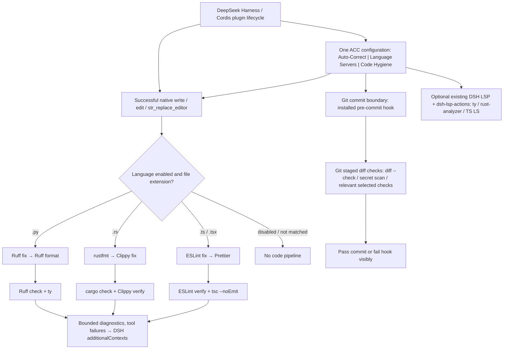

# ACC — Architecture

**Authority:** Behavior is implemented in `src/`; native registration and defaults are in `cordis.patch.yml`, package and version constraints in `package.json`. This document explains those artifacts and must not override them.

## Integration

The native implementation is in `src/index.ts`, registered on `tools/post-execute`. It uses the harness `ctx.subprocess` provider and returns remaining diagnostics as model-visible `additionalContexts` in the same tool result. The plugin package and example native profile patch are `package.json` and `cordis.patch.yml`.

**The old `hooks.json` and `check.sh` are superseded legacy experiments, not the installation method.** Do not install the third-party `dsh-plugin-hooks` for ACC.

## Execution

For successful native `write`, `edit`, and `str_replace_editor` operations, ACC resolves the actual path from the tool result (falling back to `file_path`), runs matching configured fixers in order, then runs read-only verifiers concurrently. Python defaults use Ruff fix, Ruff format, Ruff check, and ty; Rust defaults use rustfmt; shell defaults use ShellCheck. Commands are invoked without shell interpretation.

## Reused LSP actions and QDev toolchain

ACC uses the existing Apache-2.0 [dsh-lsp-actions](https://github.com/PerryLink/dsh-lsp-actions) at pinned version `0.5.17` as an ordinary package dependency. **It is one generic plugin for multiple language servers**, not one TypeScript-only language server. ACC uses its native Cordis registration instead of copying its LSP client. The provider supplies diagnostics, formatting, code actions, completion, symbols, inlay hints, signature help, and rename. DSH's own `dsh-lsp`/`dsh-lsp-stdio`/`dsh-tool-lsp` keep their four read-only navigation operations.

| Language | Existing command | Arguments | File extensions |
|---|---|---|---|
| Python | `ty` | `server` | `.py` |
| Rust | `rust-analyzer` | none | `.rs` |
| TypeScript | `typescript-language-server` | `--stdio` | `.ts`, `.tsx` |

This matches the real Docker deployment's Code-and-Quality tools installed by `l00p3rl00p/qdocker-compose/stacks/llm-runtime/install-code-and-quality.sh`, mounted read-only at `/home/qdev/llm-runtime`, with `tools/bin` and `tools/rust/cargo/bin` on the Harness PATH. **Do not run installation scripts or attempt to write inside the mounted toolchain.** The plugin resolves existing executables first. No Python, Rust, or TypeScript language server is launched for a disabled language. Enabled servers start on demand when called, and are reused per workspace.

The upstream LSP-actions dependency has its own tests for TypeScript, routing, formatting, cancellation, and sandbox/permission handling. ACC's tests exercise upstream routing for all three languages and preserve the DSH tool registry's existing action definitions when already registered. The upstream project exposes subprocess and filesystem authority; it is not sandboxed on its own. Source/compatibility review does **not** replace a live Docker Harness integration test.

This dependency is version-pinned; it is not a fork and no upstream LSP source has been copied. The connected GitHub tooling in this session does not expose repository forking. Fork only if a demonstrated defect requires an approved downstream change.

## Default behavior and configuration choices

ACC runs only after successful configured file-edit tools, selected by extension:

- Python: Ruff fix, Ruff format, Ruff verification, ty.
- Rust: rustfmt, Clippy fix, cargo check, Clippy verification. Clippy fix is project-scoped and can modify additional files. Remove `clippy-fix` from the profile override to disable it.
- TypeScript/TSX: ESLint fix, Prettier format, ESLint verification, TypeScript compiler verification. ESLint and TypeScript project configuration must exist in the target workspace.
- Shell: ShellCheck verification.

The plugin does not launch language servers; they remain editor services. No unrelated language pipeline runs on an edit.

**Profile customization:** override the `auto-code-correct` row in the profile's `cordis.patch.yml`, restating its full `config` (DSH replaces whole config rows). The `fixers` and `checkers` arrays determine which operations run; remove entries to disable them. `tools` selects edit-tool names and `maxDiagnosticChars` caps agent-visible output.

## Current implementation boundary

The repository changes have not been confirmed by a passing GitHub Actions build or a live DSH installation in this session. The plugin processes one file path per edit-tool result; it does not yet batch across tool calls. Project root discovery is based on nearest Cargo.toml for Rust and nearest tsconfig.json or package.json for TypeScript. These behaviors still need end-to-end integration testing. Do not claim inaccessible files were corrected.

## Implementation contract — restored from ACC design decisions (2026-11-01)

**ACC is one native DSH plugin, with one persistent configuration and three independently controlled settings groups: Auto-Correct, Language Servers, and Code Hygiene.** The following is the intended behavior and acceptance contract; see the implementation-status table below for what the current source actually provides.

1. **One plugin, one configuration.** One ACC bundle owns the three settings groups; language and individual-capability controls are independent, with sane, inspectable defaults. Do not create separate Python, Rust, TypeScript, or Git-hygiene plugins.
2. **Native DeepSeek Harness only.** Use Cordis plugin registration/lifecycle, native `tools/post-execute`, the DSH subprocess provider, configuration forms/editor, and supported agent/tool interfaces. Do not patch DSH source or install the historical hook experiment.
3. **Real on/off behavior.** Disabled language means no pipeline; disabled fixer/checker means it is not run; disabled language server means it is not started. A UI toggle must correspond to the actual execution path, not merely change presentation.
4. **Automatic at the appropriate event.** After an eligible successful edit, select the matching language's correction and verification pipeline without making the agent remember a command. Before an eligible Git commit, run selected staged-change hygiene automatically **once a native Git pre-commit hook has been explicitly installed**. A manually invoked historical secret scan stays manual.
5. **No redundant pipelines.** A Python edit must not launch Rust or TypeScript checks. Only enabled matching capabilities run; Git-boundary hygiene is not rerun after every edit. Reuse installed tools, existing LSP implementations and Git tooling.
6. **Visible failure semantics.** Stop subsequent mutating fixers on a fixer failure; report failure and unresolved diagnostics to the agent using the current DSH result/context channel. Never mark a failed checker as clean. Preserve the original tool outcome and admission/cancellation semantics. Do not claim a failed tool edit succeeded.
7. **Persistent settings.** Native DSH profile configuration and ConfigForms/editor changes must survive restart and actually govern the plugin after reload. CLI tool ownership records live in their separate ACC state ledger, not the settings source of truth.
8. **Verifiable package.** GitHub Actions must build the installable package and test loading the native plugin, the three settings groups and their enable/disable effects, pipeline gating, Git hygiene and persisted behavior. A passing CI build is not proof of a live Docker Harness installation.
9. **No upstream patching or extra integration code without approval.** Audit existing native capabilities first. Reuse the actual code-quality installation; avoid unapproved Docker service additions or parallel linters.

### Two-event architecture

The diagram is a **design and existing-seam map**, not a claim that every arrow is operational by default. The normal DSH post-edit path exists. Git checks are implemented in `src/cli.ts` but only attach to commit events when `acc-tools hooks install` is explicitly invoked (and will refuse to replace an existing pre-commit hook or configured `core.hooksPath`). The LSP branch runs independently from edit-time fix/verify.

### Language-specific post-edit pipeline — exact intended sequence

| Edited file | Sequential mutating correction (stop later mutations if one fails) | Read-only verification after correction (may run concurrently) | Source |
|---|---|---|---|
| Python `.py` | `ruff check --fix {file}` → `ruff format {file}` | `ruff check {file}` + `ty check {file}` | `cordis.patch.yml` |
| Rust `.rs` | `rustfmt --edition 2021 {file}` → `cargo clippy --fix --allow-dirty --allow-staged -- -D warnings` | `cargo check` + `cargo clippy -- -D warnings` | `cordis.patch.yml` |
| TypeScript `.ts`, `.tsx` | `eslint --fix {file}` → `prettier --write {file}` | `eslint {file}` + `tsc --noEmit` | `cordis.patch.yml` |

Rust project-scoped Clippy fixes can modify **other** files and are potentially disruptive in a shared tree; the user-approved config decides whether to enable them. The plugin's default language masters are **Python enabled, Rust and TypeScript disabled**, so the table describes their configured pipelines **when enabled**, not a claim all three run on install. Existing config also includes a `shellcheck` checker for `.sh`, but the current `languageForExtension` path admits only Python/Rust/TypeScript; ShellCheck belongs to explicit Git hygiene (or requires an approved implementation change to run post-edit). Do not promise automatic post-edit ShellCheck until verified.

### Git-related checks — same ACC, different event

| Event | Intended checks | Actual implementation and exact source |
|---|---|---|
| **After successful code edit** | Language-specific fix, format and type/lint verification | `src/index.ts` on DSH `tools/post-execute` with `cordis.patch.yml` |
| **Before Git commit** | `git diff --cached --check`, staged secret scanning, staged large-file checks, optional staged ShellCheck and selected hygiene checks; fail the commit on failure | `src/cli.ts` implements `acc-tools hygiene` and `acc-tools hooks install` (Git-native `.git/hooks/pre-commit`), **not automatically installed** by the DSH plugin |
| **Manual / CI boundaries** | `npm audit --audit-level=high`, `license-checker --summary`, full Git history Gitleaks scan, GitHub Actions verification | `src/cli.ts`, `.github/workflows/ci.yml`; selected optional checks must be explicitly enabled/invoked |

The Git hook invokes the ACC CLI in the Git repository, not a separate DSH event API. Its effective hygiene set comes from **project-local `.acc-hygiene.json`** when no check IDs are passed; fallback is `git-diff`, `gitleaks`, `large-files`. The `src/client/index.tsx` Code Hygiene switches currently persist `capabilities` in DSH's native ConfigForms, but **`src/cli.ts` does not read those same toggles**: its hook reads `.acc-hygiene.json`. This is a **verified contract gap**. Do not claim the UI switch controls Git hook behavior until both use one effective configuration source. Keep the desired one-configuration rule; do not add another authoritative settings store.

### Three settings groups and current delivery status

| Group | Current source | Delivered | Still requiring proof or reconciliation |
|---|---|---|---|
| **Auto-Correct** | `src/index.ts`, `cordis.patch.yml`, `src/capabilities.ts` | Cordis post-edit listener, language/capability gating, ordered fixers, parallel read-only checks, model-visible findings | Live installed DSH verification; exact tools and Git changes at real runtime; default only Python enabled |
| **Language Servers** | `src/index.ts`, `src/client/index.tsx`, `dsh-lsp-actions` dependency | Language and language-server gates, existing DSH LSP stdio/provider integration, reuse rather than separate LSP engine | Live DSH startup and shutdown/reload behavior in each language; persistence across restart |
| **Code Hygiene** | `src/cli.ts`, `src/client/index.tsx` | Staged Git diff, Gitleaks, staged large-file checks, optional ShellCheck/audits and Git pre-commit hook installation | Hook is **opt-in**; native UI capability switches and project-local hook selections are not synchronized; end-to-end pre-commit failure and persistence proof |
| **Packaging and verification** | `package.json`, `.github/workflows/ci.yml`, `test/` | Build/typecheck/lint/tests/pack/install-profile steps declared; test files cover admission/config/discovery/LSP | Confirm the actual workflow results and add explicit whole-contract tests for three groups, on/off, Git hook and settings persistence |

The current code runs verification even after a mutating fixer fails, and returns those findings; it does **not** proceed to further mutating fixers. A checker failure is reported as a finding; ACC does not itself turn the original successful edit into a blocked tool execution. That distinction is intentional and must be tested against the desired visibility contract.

### Boundaries and authoritative implementation links

- `src/index.ts`: post-edit listener, pipeline admission, subprocess, diagnostics injection and LSP integration.
- `src/client/index.tsx`: three-group configuration UI via native DSH ConfigForms.
- `src/capabilities.ts`: canonical capability IDs and per-language grouping.
- `src/cli.ts`: Git hygiene commands, pre-commit hook, ownership ledger and tool-manager CLI.
- `src/commands.ts`: DSH `/acc` human command.
- `cordis.patch.yml`: currently configured fixer/checker command argv and language defaults.
- `package.json`: packaged plugin, dependencies, build and verification commands.
- `.github/workflows/ci.yml`: actual CI definition.

